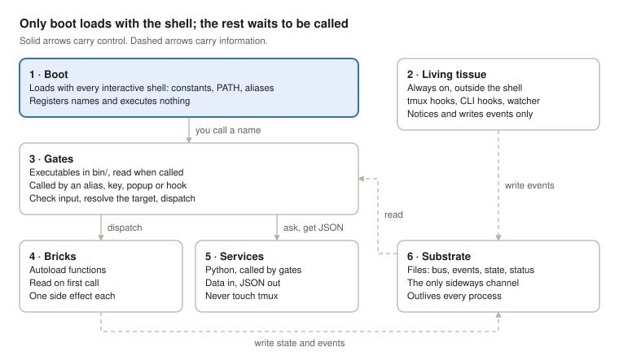
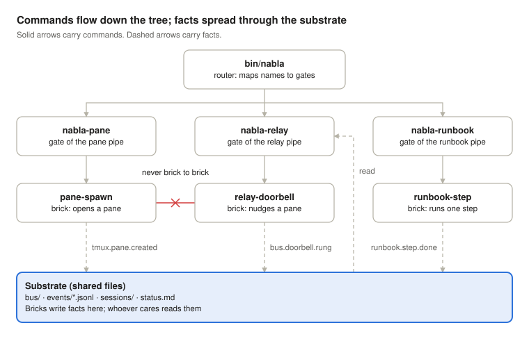
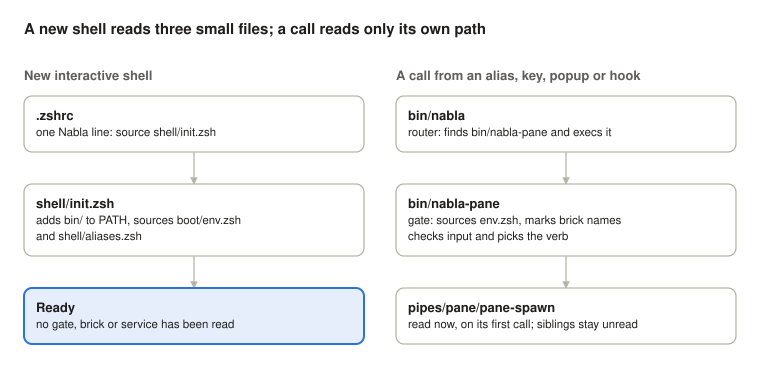
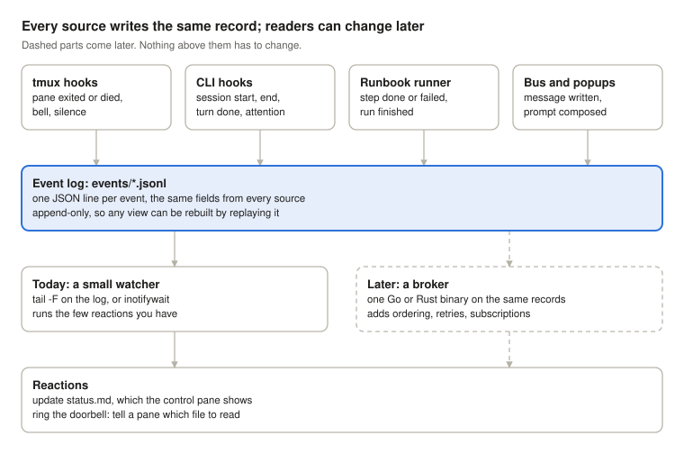
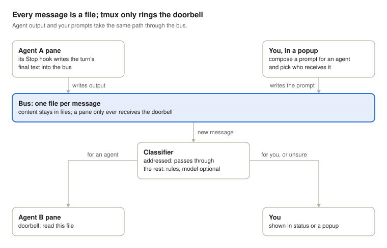

# Nabla.Tmux — Architecture Draft v0

Oct 17, 2026 · @Michal Hrůza

## The idea

Nabla.Tmux is an organism of small zsh bricks that runs live CLI agent sessions in tmux. It grows in two shapes at once: a tree for control and a mycelium for information.

In the tree, commands flow down from the router through gates to bricks, so every command has exactly one path. In the mycelium, events and state spread sideways through shared files, so bricks connect without knowing each other.

Two rules complete the picture. Content always travels in files, and tmux only rings the doorbell. Only a thin layer stays awake; everything else sleeps until something calls it.

## Principles

Eight rules hold the build together. The sixth matters most for what you have now: anything tmux triggers cannot see your aliases.

| Rule | Why |
| --- | --- |
| 1. Control flows down the tree. | One path per command keeps behaviour predictable and debuggable. |
| 2. Information flows sideways through the substrate, never brick to brick. | Bricks stay independent, and every link is visible in the files. |
| 3. Load cost follows use. | Startup stays flat however many bricks you add. |
| 4. Content lives in files; tmux only rings the doorbell. | Files survive crashes and can be replayed. Text typed into a pane cannot. |
| 5. Python computes, zsh acts. | Side effects live in one layer, so a broken pane points to one place. |
| 6. Edges are executables, insides are autoload functions. | tmux hooks, popups and CLI hooks run in non-interactive shells, which never see aliases or `.zshrc` functions. |
| 7. Commands are imperative, events are past tense. | `nabla pane spawn` asks; `tmux.pane.created` reports. Mixing them hides who is in charge. |
| 8. Optional parts fail soft. | The relay must still work with the local model or a future broker switched off. |

## Layers

Six layers, sorted by when they load and what each may do. A script that fits no single layer is doing two jobs; split it.



*six layers · solid arrows carry control, dashed arrows carry information*
Only boot costs anything at shell start; living tissue runs outside the shell, and everything else waits to be called.

## If you think in Laravel

Most of the structure maps onto Laravel. The main shift: every call is its own process, and files stand in for the database and the queue.

| Nabla | Laravel | What carries over |
| --- | --- | --- |
| `nabla <pipe> <verb>` | `php artisan <command>` | One entry point, many commands. |
| Router (the `bin/` folder) | `routes/` | Maps names to handlers and runs nothing itself. |
| Pipe | Route group, e.g. `Route::prefix('pane')` | A named area of verbs behind one entry. |
| Gate | Controller with its FormRequest | Validates input, resolves context, dispatches. Not Laravel's authorization `Gate`. |
| Brick | Action or Job class | One side effect. |
| Python service | Plain service class | Computes and returns data; touches nothing. |
| Arguments passed down | Dependency injection | A brick gets what it needs and never reaches up for globals. |
| `autoload -Uz` + `fpath` | Composer PSR-4 autoload | Code is read on first use. |
| Constants file | `config/*.php` + `.env` | Settings in one place; code stays stateless. |
| Substrate (files) | Database, queue, cache, storage | Shared state, and the only sideways channel. |
| Event record | Event class | A fact, named in the past tense. |
| Watcher reaction | Listener | Runs when a matching event lands. |
| Broker (later) | Queue worker, Horizon | Ordering, retries, many listeners. |
| tmux hooks | Model observers | Run without anyone typing a command. |
| Runbook | Artisan command built on a Pipeline | Ordered steps that stop on failure. |
| Popup | Blade form | Collects input, stores it, hands it on. |

## Tree and mycelium

Use both shapes on purpose: the tree for control, so every command has one path, and the mycelium for information, so bricks connect without knowing each other.



*control tree over a shared substrate · one forbidden link*
A brick never calls another brick; it writes a fact into the substrate, and whoever cares reads it. Biology calls this stigmergy: coordination through traces left in a shared environment.

## What loads when

A new shell reads three small Nabla files; a call reads only the files on its own path.



*shell start versus one call · what each reads*
Every other gate, brick and service stays on disk until something calls it, so adding a hundred bricks adds nothing to shell startup.

## Code layout and file naming

One repository holds the code, and the folder a file sits in decides its layer.

```
nabla/
├── bin/                  # edges: executables anything can call
│   ├── nabla             # router: nabla <pipe> <verb> → bin/nabla-<pipe>
│   ├── nabla-pane        # gate of the pane pipe
│   ├── nabla-relay
│   ├── nabla-runbook
│   └── nabla-ui
├── pipes/                # insides: bricks, one autoload function per file
│   ├── pane/             # pane-spawn, pane-name, pane-close
│   ├── relay/            # relay-route, relay-doorbell
│   └── runbook/          # runbook-step
├── lib/                  # shared helpers: emit-event, atomic-write, log
├── services/             # Python, pure: args or stdin in, JSON out
├── hooks/                # living tissue: on-tmux-event, on-cli-event
├── ui/                   # popup and menu front-ends
├── boot/
│   └── env.zsh           # constants, sourced by the shell and by every gate
├── shell/                # interactive only
│   ├── init.zsh          # the one file .zshrc sources
│   └── aliases.zsh       # sugar: alias np='nabla pane spawn'
├── tmux/
│   └── nabla.tmux.conf   # hooks, key bindings, popups
└── runbooks/             # runbook definitions
```

| File kind | Name and extension | Example |
| --- | --- | --- |
| Executable | No extension; the shebang picks the language | `bin/nabla-pane` |
| Autoload function | File name equals the function name, no extension | `pipes/pane/pane-spawn` |
| Sourced file | `.zsh` | `boot/env.zsh` |
| Python service | `.py` with a shebang, called like any executable | `services/classify.py` |
| POSIX shell | `.sh`, only for code that must run where zsh is not installed | none yet |

Brick names start with their pipe (`pane-spawn`), so a name tells you which gate owns it. A gate lists its public verbs; everything else in its folder is private to that pipe. Another pipe that needs it calls `nabla pane name …`, never the function directly.

## Substrate

The substrate splits by lifetime: config you set, state the animal writes and must keep, and runtime files that may vanish on reboot.

```
~/.config/nabla/config.zsh      # per-machine overrides (XDG_CONFIG_HOME)
~/.local/state/nabla/           # durable state (XDG_STATE_HOME)
├── bus/                        # the message bus, as you built it
├── events/2026-10-17.jsonl     # append-only event log, one file per day
├── sessions/<name>.json        # one record per agent session
├── status.md                   # shown in the control pane
└── bricks/<brick>/             # private state, one folder per brick
$XDG_RUNTIME_DIR/nabla/         # locks, pids, fifos: gone on reboot
```

Keeping the three apart lets you wipe state without losing settings, and back up config without logs. A brick that needs memory gets its own folder under `bricks/`, and nothing else writes there. Every other file in state also has exactly one writer.

Facts tied to a pane's life, such as its role or agent type, go in tmux user options like `@nabla_role`. They disappear with the pane, which is correct. Anything that must outlive the pane goes in a file.

If no login stays open on the office machine, `$XDG_RUNTIME_DIR` is removed when your last SSH session closes, even while tmux keeps running. Run `loginctl enable-linger` once to keep it, and any user services, alive.

The bus stays as you built it. If it ever shows races, such as two readers taking one message or a reader catching a half-written file, the standard fix is the maildir pattern: write into `tmp/`, rename into `new/`, and the reader moves the file to `cur/`. A rename on one filesystem is atomic, so a file is either complete or absent.

## Events

Every event, from any source, is one JSON line in the same format. The format is the commitment; whatever reads it can change later.



*four sources, one log, two readers · dashed parts come later*
Today a watcher runs the reactions; later a broker reads the same lines, and no source has to change.

### Record format

```json
{"v":1,"ts":"2026-10-17T14:03:22Z","type":"cli.turn.finished","source":"%12","payload":{"session":"agent-a"}}
```

| Field | Meaning |
| --- | --- |
| `v` | Format version, so a later reader can handle old and new lines. |
| `ts` | UTC time. |
| `type` | `<domain>.<thing>.<what happened>`, past tense. |
| `source` | Who noticed it: a pane id or a hook name. |
| `payload` | Small details such as the session. Big content stays in a file, and the payload holds its path. |

### Lifecycle map, first pass

| Event | Source |
| --- | --- |
| `cli.session.started` | Claude Code `SessionStart` hook (startup, resume, clear, compact, fork) |
| `cli.turn.finished` | Claude Code `Stop` hook; Codex `notify` |
| `cli.turn.failed` | Claude Code `StopFailure` hook: the turn ended on an API error |
| `cli.attention.needed` | Claude Code `Notification` hook; tmux `alert-bell` |
| `cli.session.ended` | Claude Code `SessionEnd` hook; tmux `pane-exited` |
| `cli.session.crashed` | tmux `pane-died` with a non-zero `#{pane_dead_status}`; needs `remain-on-exit on` |
| `cli.session.silent` | tmux `alert-silence` after `monitor-silence` seconds; works best with one agent per window |
| `tmux.session.created` | tmux `session-created` |
| `runbook.step.done`, `runbook.step.failed` | The runbook runner, from each step's exit status |
| `bus.message.written` | The watcher, on a new file in the bus |
| `ui.prompt.composed` | The popup, when you send |

Claude Code hook names and behaviour: [Claude Code hooks reference](https://code.claude.com/docs/en/hooks.md).

The `Stop` hook receives the turn's final text as `last_assistant_message`, so the hook can write the agent's output into the bus itself, with no screen reading. End every CLI hook script with `exit 0`: on `Stop`, exit code 2 tells Claude to keep working.

`SessionEnd` hooks share a 1.5-second budget by default, so they should only append the event line. When the broker arrives, tmux control mode (`tmux -C`) can feed it directly, since it streams tmux's own events.

## Messages: relay and popups

Every message is a file, and a pane only ever receives the doorbell: a one-line nudge that names the file to read.



*one bus for agent output and your prompts · rules first, model optional*
The classifier is where automation starts: it replaces your eyes deciding whether an output is for another agent or for you. With the model switched off, everything the rules cannot place goes to you, which is how it works today anyway.

A popup is a gate with a face: `display-popup -E` runs a small composer such as fzf, gum or a Python TUI, and `display-menu` covers quick picks. The popup writes into the bus and never types into another session, so Tembrana fits this shape as it is.

The doorbell brick types its nudge with `tmux send-keys -l`, so the text is sent literally, then sends `Enter` as a separate key.

## Runbooks and the control pane

A runbook is a command file, so it gets a runner like any script: steps run in order, each one reports an event, and a failure stops the run unless the step allows it.

Give every step a short id. The runner emits `runbook.run.started`, then `runbook.step.done` or `runbook.step.failed` with that id and the exit status, and finally `runbook.run.finished`.

`status.md` has one writer: the watcher. Bricks and the runner report through events and never edit status directly, so whatever the control pane shows can be traced back to the log. The control pane only displays the file and holds no logic.

## Which language goes where

zsh by default, Python for logic, POSIX sh only where zsh cannot run, and a compiled binary later for the broker.

| Language | Use it for | Why |
| --- | --- | --- |
| zsh | Orchestration and side effects: tmux, processes, files, glue | Native at these, and already your shell. |
| Python | Parsing, JSON, decisions, anything over \~100 lines or worth testing | Real data structures, tests, libraries. |
| POSIX sh | Code that must run where zsh is not installed | Otherwise one dialect means one set of quirks. |
| Go or Rust (later) | The broker: long-running, concurrent, structured | One static binary with real concurrency. |

Python never touches tmux. It receives data as arguments or stdin and prints a result, ideally JSON; the gate or brick that called it does the side effect.

tmux runs hook commands through `/bin/sh`, but a zsh script with a shebang runs fine from there. So tmux is no reason to write `.sh`.

## Decisions and when to revisit them

Each decision is a default with a reason. The last column names the signal that should reopen it.

| Decision | Reason | Revisit when |
| --- | --- | --- |
| One dispatcher: `nabla <pipe> <verb>` | One entry point, lazy, callable from tmux, popups and CLI hooks | A verb must change your current shell (`cd`, `export`): make that one an autoload function in `shell/`. |
| Bricks are autoload functions inside their gate | No process per brick; each file is read on first call | A brick must run on its own, in the background or for long: make it an executable in `hooks/` or a service. |
| The `bin/` folder is the registry | Nothing to keep in sync; `nabla` lists pipes by globbing | You need per-verb help or flags: add a header-comment convention, still no central file. |
| Events in a JSONL log | No dependencies; `tail`, `grep` and replay work out of the box | You ask questions across days or sessions: move the log to SQLite. |
| No broker yet | Few reactions, and none depends on another | Events start to chain, or you need ordering or retries. |
| Pane-lifetime facts in tmux options | They die with the pane, which is correct | The fact must survive the pane: move it to a file. |
| Rules before the model in the classifier | Predictable, testable, works offline | Rule misses fill most of your human queue. |
| zsh everywhere except services | One dialect | Code must run without zsh. |

## Migration path

Move one pipe at a time while the old config keeps working beside the new layout. The old file shrinks until you can delete it.

1. Measure first: `zmodload zsh/zprof` at the top of `.zshrc`, `zprof` at the bottom, and `hyperfine 'zsh -i -c exit'`. That is your baseline.
2. Add `shell/init.zsh`, `boot/env.zsh` and `bin/nabla`, and keep sourcing the old config next to them.
3. Move one pipe: its gate goes to `bin/nabla-<pipe>`, its scripts to `pipes/<pipe>/` as autoload functions, and its aliases now call `nabla <pipe> <verb>`. Then delete that pipe's line from the old config.
4. Repeat pipe by pipe, converting `.sh` files to zsh as you touch them.
5. Move every tmux call out of the Python scripts into bricks, so services only print results.
6. Fix the event format, then wire the CLI hooks and tmux hooks to it.
7. Hand `status.md` and the doorbells to the watcher.
8. Delete the old config once it is empty, and measure again.
9. Add the broker only when events start to chain.

## Skeleton

Six small files run the new structure end to end: boot, constants, router, one gate, one brick and the event helper. Create `~/.local/state/nabla/events/` once at install.

`shell/init.zsh`

```zsh
# the only Nabla line in .zshrc is:  source ~/nabla/shell/init.zsh
NABLA_HOME=${${(%):-%x}:A:h:h}         # the repo this file lives in
path=($NABLA_HOME/bin $path)           # edges become callable by name
source $NABLA_HOME/boot/env.zsh        # constants
source $NABLA_HOME/shell/aliases.zsh   # sugar only, e.g. alias np='nabla pane spawn'
```

`boot/env.zsh`

```zsh
# constants only; sourced by init.zsh and by every gate
: ${NABLA_STATE:=${XDG_STATE_HOME:-$HOME/.local/state}/nabla}
: ${NABLA_RUNTIME:=${XDG_RUNTIME_DIR:-/tmp}/nabla}
NABLA_BUS=$NABLA_STATE/bus
if [[ -r ${XDG_CONFIG_HOME:-$HOME/.config}/nabla/config.zsh ]]; then
  source ${XDG_CONFIG_HOME:-$HOME/.config}/nabla/config.zsh   # per-machine overrides
fi
```

`bin/nabla`

```zsh
#!/usr/bin/env -S zsh -f
# router: nabla <pipe> <verb> [args] -> bin/nabla-<pipe>; the folder is the registry
gate=${0:A:h}/nabla-${1:-}
if [[ -n ${1:-} && -x $gate ]]; then
  shift
  exec $gate "$@"
fi
gates=( ${0:A:h}/nabla-*(N:t) )
print -u2 "usage: nabla <pipe> <verb> [args]   pipes: ${gates#nabla-}"
exit 64
```

`bin/nabla-pane`

```zsh
#!/usr/bin/env -S zsh -f
# gate: checks input, resolves the target, dispatches; no side effects of its own
setopt err_exit no_unset pipe_fail
NABLA_HOME=${0:A:h:h}
source $NABLA_HOME/boot/env.zsh
fpath=($NABLA_HOME/pipes/pane $NABLA_HOME/lib $fpath)
autoload -Uz $NABLA_HOME/{pipes/pane,lib}/*(N.:t)   # names only; a file is read on first call

verb=${1:-}; shift $(( $# > 0 ))
case $verb in                                        # the pipe's public verbs
  spawn|name|close) pane-$verb "$@" ;;
  *) print -u2 "usage: nabla pane spawn|name|close ..."; exit 64 ;;
esac
```

`pipes/pane/pane-spawn`

```zsh
# brick: open one window in a session and tag its pane. Usage: pane-spawn <session> <name>
emulate -L zsh; setopt err_return no_unset
local session=$1 name=$2 pane
pane=$(tmux new-window -d -P -F '#{pane_id}' -t "$session:" -n "$name")
tmux set-option -p -t "$pane" @nabla_role agent
emit-event tmux.pane.created pane=$pane name=$name session=$session
```

`lib/emit-event`

```zsh
# helper: emit-event <type> [key=value ...] appends one JSON line to today's log
emulate -L zsh; setopt err_return no_unset
local type=$1 kv; shift
local -a named
for kv in "$@"; do named+=(--arg "${kv%%=*}" "${kv#*=}"); done
jq -cn --arg type "$type" --arg source "${NABLA_SOURCE:-${TMUX_PANE:-unknown}}" "${named[@]}" \
  '{v: 1, ts: (now | todate), type: $type, source: $source, payload: ($ARGS.named | del(.type, .source))}' \
  >> $NABLA_STATE/events/${(%):-%D{%Y-%m-%d}}.jsonl
```

`zsh -f` in the shebang skips your personal startup files, so a gate behaves the same whether a shell, a tmux hook or a popup calls it. Each gate then loads its own pipe and nothing more.

## Study list

Start with the first five; each of the rest can wait until the migration step that needs it. Every topic comes with a first exercise on Nabla itself.

| Topic | Why it matters here | Try it on Nabla |
| --- | --- | --- |
| zsh startup files: `.zshenv`, `.zprofile`, `.zshrc` | `.zshenv` runs for every zsh, scripts included, so it sets the floor of your load cost | Check what your `.zshenv` loads today and move anything heavy to `.zshrc`. |
| `autoload -Uz`, `fpath`, `zcompile` | The dormant layer: functions read on first call | Move one alias's code into `pipes/pane/` and call it through the gate. |
| tmux hooks, formats and user options | The living tissue: `set-hook`, `#{pane_id}`, `@nabla_role` | Hook `pane-exited` to append a line to a test file. |
| Atomic rename and the maildir pattern | Keeps the bus safe from half-written or double-read files | Write a message into `tmp/`, `mv` it into place, and check a reader never sees it half done. |
| Stigmergy and blackboard architecture | The established names for your mycelium idea, with decades of prior work | Read one overview of each and compare it with the substrate section. |
| `zsh/zprof` and `hyperfine` | Measure before and after every change | Record the baseline from migration step 1. |
| `zparseopts` | One argument style for every gate | Give `nabla pane spawn` a `--session` flag. |
| `run-shell`, `display-popup`, `display-menu` | How tmux runs your code and shows your UI | Bind a key that opens a popup running `nabla ui compose`. |
| `monitor-silence`, `remain-on-exit`, `#{pane_dead_status}` | Hang and crash detection without reading the screen | With `remain-on-exit on`, kill an agent CLI and read its exit status from the dead pane. |
| tmux `wait-for` | One script waits for another without a broker | Make a runbook step wait until an agent signals it is done. |
| tmux control mode (`tmux -C`) | tmux as a stream of events, the natural feed for a later broker | Attach in control mode and watch what one `new-window` prints. |
| Exit codes and `sysexits.h` | A shared failure vocabulary: 64 bad usage, 69 unavailable, 75 retry later | Make every gate exit 64 on bad input. |
| JSON Lines and `jq` | One event per line: greppable and replayable | List today's `cli.turn.finished` events with one `jq` filter. |
| `inotifywait` and `entr` | React to file changes without polling | Re-render the control pane whenever `status.md` changes. |
| XDG Base Directory spec | Where config, state and runtime files belong | Move one state file out of the repo into `~/.local/state/nabla/`. |
| systemd user units and lingering | Keep the watcher, and later the broker, running and restarted | Run the watcher as a `--user` service with `Restart=on-failure`. |
| Commands versus events (CQRS basics) | Why commands go down the tree and events go sideways | Sort your current aliases into commands, then name the event each should emit. |
| Strangler fig pattern | Replacing the old router piece by piece, as in the migration path | Pick the first pipe to move. |
| *The Art of Unix Programming* (Raymond) | The rules of modularity, composition and separation behind all of this | Read the 17 rules in chapter 1. |

## Glossary

One word, one meaning, so names in code and in conversation stay the same.

| Term | Meaning |
| --- | --- |
| Animal | The whole build. |
| Router | `bin/nabla`: maps a pipe name to its gate and runs nothing itself. |
| Pipe | A named area of verbs behind one gate, such as `pane` or `relay`. |
| Gate | A pipe's executable entry: checks input, resolves context, dispatches. |
| Brick | An autoload function with exactly one side effect. |
| Service | A Python program that computes and returns data. |
| Substrate | The shared files: bus, events, state, status. |
| Bus | Where messages between sessions live as files. |
| Event | A one-line record of something that happened, named in the past tense. |
| Doorbell | A short nudge typed into a pane: which file to read. |
| Living tissue | Hooks and watchers that react without anyone typing a command. |
| Dormant | Registered by name, read from disk only when called. |
| Runbook | A command file that describes how to run a session. |
| Control pane | The pane that displays `status.md`. |
| Broker | A later long-running process that routes events with ordering and retries. |
