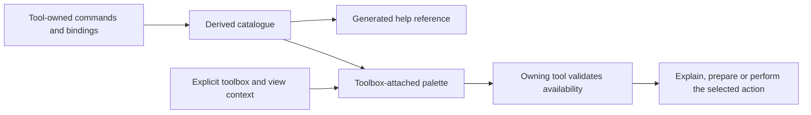

# Keyboard, command discovery and toolbox-attached palettes

`for: Majkee and Houston, early architecture-sitting discussion`
`prepared: myShell / Cartan, 2026-10-21`
`status: research and proposed directions; UNCANONICAL; no keymap, registry schema or implementation selected`
`authority: Majkee requested deep research and authorized this specific raw/ brief`
`relation: architecture G3 remains unanswered; this brief supplements its narrow relocation question`

## Conclusion for the sitting

Majkee's problem is broader than relocating KEYS CODE: the animal needs coherent action
meanings, visible command discovery, comfortable direct access and help that remains true.
The palette must belong to the toolbox being used, even if displayed in another pane/window.
An unconnected global command launcher does not meet that requirement.

The strongest proposed direction is **tool-owned command/binding truth, a derived catalogue,
and toolbox-attached discovery**, with narrowly owned semantic metadata added where actual
sources cannot supply meaning or availability. This is myShell's synthesis of the research
and Oraculum's critique, not an architectural lock. A universal registry/dispatcher is a
larger alternative whose ownership and migration cost have not been justified yet.

Keep the keyboard design open and early on Houston's plate, as Majkee asked. Distinguish
relocating the accepted current grammar from choosing its future normalization architecture.
Moving the present baseline does not settle the new design; deferring the move does not
complete that design either. No a/b/c answer is inferred by this brief.

## Operator intent and research provenance

Majkee reports that terminal, tmux/Ovitmugen, Termbrana and editor views require too many
separate key vocabularies. He wants a whole-animal key/command view, a HELP.md surface,
generic patterns where possible, support for Linux/terminal/tmux/Sublime conventions,
and faster command access than walking long menu trees. The earlier Ovitmugen discussion
was interrupted by an electricity outage and deliberately not restarted while the main
architecture remained unsettled.

He adds PC-gamer patterns and ergonomic best practices as hypotheses, not a chosen layout.
His subsequent placement requirement is verbatim:

> BUT from now | here palette should part of body (maybe another window|pane but must be conected to used toolbox in that time).

Research roles: an Explorer read the local implementation; two researcher seats used
GPT-5.6-Terra/high for host constraints and gaming/accessibility/HCI; native Oraculum used
GPT-6-Astra/high for strategic critique. myShell checked the load-bearing local snippets
and primary sources. These are role/configuration observations, not runtime parity claims.

No live UI, generator, key capture, product test or user comparison was run. Keyboard
layouts, IME use, handedness and existing gamer/Vim familiarity remain unknown. Official
pages were checked on 2026-10-21; installed-host behavior still needs qualification.

## The distinctions the design must preserve

| thing | example | why it matters |
|---|---|---|
| Meaning/action | search this view, open selection, close view | Similar labels can hide different objects or consequences. |
| Implementing command | a shell function, tmux command or editor command | The owning tool knows what it can do and under what conditions. |
| Binding | a key/sequence in a named host, view and mode | A printed chord alone does not identify its effective behavior. |
| Discovery | attached palette, visible hint, HELP reference | Can teach the direct path without making search mandatory every time. |
| Invocation effect | explain, insert, prepare, execute, request delivery | Selecting a name must not silently change one effect into another. |

For example, closing a view and stopping its underlying process must not collapse into
one generic back/quit operation. Likewise, searching help and searching editor text can
share a familiar idea while retaining their owner and target.

## What local sources already provide

| mechanism | observed source behavior | remaining gap |
|---|---|---|
| [Claviature spec](/home/hruzam/ia-sync/zsh/guides/claviature.global.spec.md) and [keys engine](/home/hruzam/ia-sync/zsh/ai/keys.zsh) | Derive live shell aliases/functions, grouped by registered families; unknown names remain visible. | They do not catalogue physical bindings or application contexts. Current family map lacks rb/ov/tn groups. |
| [Palette wiring](/home/hruzam/ia-sync/zsh/ai/keyboard.zsh:198), [adapter](/home/hruzam/ia-sync/zsh/ai/command-palette.zsh:128), [TUI](/home/hruzam/ia-sync/zsh/ai/command-palette.py) | command-palette and Alt-k exist in source. Selection can insert a command at the ZLE cursor without executing it. Search covers command names/descriptions. | This is shell discovery prior art, not the requested toolbox-attached action/availability system. Live wiring was not tested. |
| [Palette map generator](/home/hruzam/ia-sync/zsh/ai/palette-map-gen.py) and [scope list](/home/hruzam/ia-sync/zsh/registries/palette.json) | Harvest source command names and help under explicitly selected roots. | session and termbrana are outside current scopes. Extending that scope needs its existing owner's disposition. |
| [Palette freshness](/home/hruzam/ia-sync/zsh/ai/command-palette.zsh:54) | Plain invocation can regenerate for newer zsh source files. | Alt-k bypasses that regeneration path; registry/generator edits and deletions are not covered by that timestamp rule. These are source findings, not observed live failures. |
| [HELP discovery](/home/hruzam/ia-sync/zsh/session/runbook.py:1315) and [key legend](/home/hruzam/ia-sync/zsh/session/help/keys/HELP.md) | Named HELP.md scopes and search already exist. | The key legend is manually transcribed and says dispatch code wins disagreements. Automatic whole-animal HELP maintenance was not found. |
| [KEYS CODE](/home/hruzam/unikuklatrix/nablarva/PROJECT-DESIGN.md:287) | Accepted TUI meanings, reserved host keys, organ-owned code and listed deviations. | Prose conformity is not proof of current runtime conformity; Ovitmugen basement normalization remains unfinished. |

cs-palette is a cold-start-card tool, not another name for the global command selector.
The existing claviature rule rejects a separately maintained exhaustive key inventory;
it already permits family registration and generated discovery. A user-visible registry
could be a generated catalogue. If new authoritative action metadata is needed, its
maintenance/ownership must be explicit rather than disguised as derivation.

## Host constraints: why consistency needs contexts

Desktop-global keys are an outer scope. The XDG GlobalShortcuts interface explicitly
addresses shortcuts active independently of application focus and desktop-controlled
bindings. An attached toolbox palette need not claim that scope. [XDG specification](https://flatpak.github.io/xdg-desktop-portal/docs/doc-org.freedesktop.portal.GlobalShortcuts.html)

Layouts and modifiers are interpreted before many applications see a key. GDK documents
keycodes, symbols, groups and consumed modifiers; input methods can compose text through
several events. This is relevant background for layouts/AltGr/Compose/IME, not a claim
that every toolbox uses GTK. [GDK keys](https://docs.gtk.org/gdk4/keys.html),
[GTK input context](https://docs.gtk.org/gtk4/class.IMContext.html)

Conventional terminal encodings can collapse Ctrl-I with Tab and Ctrl-M with Return;
termios input processing can further translate or consume controls according to mode.
Modern extended-key protocols can expose more distinctions, so qualify the exact path
rather than declaring these collisions universal. [Linux termios](https://man7.org/linux/man-pages/man3/termios.3.html),
[tmux modifier-key explanation](https://github.com/tmux/tmux/wiki/Modifier-Keys)

The tmux wiki itself warns that parts of that modifier page are outdated as of 3.5.
Use the current manual and the installed version for implementation decisions. tmux has
root, prefix, custom and copy-mode tables. Its extended-key input reporting and outbound
escape passthrough are different features; neither automatically removes desktop conflicts.
[Upstream tmux manual](https://raw.githubusercontent.com/tmux/tmux/master/tmux.1)

Sublime maps commands and arguments to keys under context predicates such as panel focus,
syntax or overlay state. That supports a tool-attached adapter while retaining native
editing. It does not prove compatibility with the actual user/package overrides.
[Sublime key bindings](https://www.sublimetext.com/docs/key_bindings.html)

Lite XL also exposes predicate-guarded commands and a palette, but its documented keymap
does not support consecutive sequences such as Ctrl-K then Ctrl-B. This is a portability
constraint to investigate, not a reason by itself to switch editors. Laravel equivalence
has not been established. [Lite XL commands](https://lite-xl.com/developer-guide/commands-and-shortcuts/commands/),
[shortcut management](https://lite-xl.com/developer-guide/commands-and-shortcuts/managing-keyboard-shortcuts/)

## Gaming, accessibility and shortcut-learning evidence

The useful gaming contribution is broader than WASD: actions can be remapped, updated
hints should reflect effective mappings, keyboard alternatives should exist, and UI
navigation need not require simultaneous or rapid inputs. Xbox's guidance explicitly
addresses these barriers and says remapping alone is insufficient. This is gaming
accessibility guidance, not a medical claim or proof of the best keys for Majkee.
[Xbox Accessibility Guideline 107](https://learn.microsoft.com/en-us/xbox/accessibility/xbox-accessibility-guidelines/107)

WCAG's printable-shortcut and keyboard-exit criteria offer useful analogies: allow
focus-scoping, disabling/remapping and a discoverable exit. They are web standards;
this brief does not claim desktop/TUI conformance from them.
[WCAG character shortcuts](https://www.w3.org/TR/WCAG22/#character-key-shortcuts),
[keyboard exit](https://www.w3.org/TR/WCAG22/#no-keyboard-trap)

KeyMap, by Lewis, d’Eon, Cockburn and Vogel (CHI 2020), compared a spatial keyboard display
with ExposeHK in a 98-participant study. Its results support investigating visible,
spatially associated shortcut hints and retention. The experiment was not a terminal,
Nablarva or WASD study. [Author-hosted paper](https://gregdeon.com/files/lewis-2020-CHI-keymap.pdf)

Grossman, Dragicevic and Balakrishnan (CHI 2007) tested interventions that improved
hotkey adoption in their GUI experiment. The relevant hypothesis is support for learning
within the primary workflow. This is not an instruction to force shortcuts by disabling
ordinary menu/palette access. [Author-hosted paper](https://www.dgp.toronto.edu/public_user/ravin/papers/chi2007_learninghotkeys.pdf)

These sources justify comparing palette/search, visible key hints and direct shortcuts
together. They do not establish gamer familiarity, comfort, an optimal layout or a single
universal chord scheme for this operator.

## Hypotheses to keep open

| hypothesis | comparison or observation that could challenge it |
|---|---|
| Shared meanings plus native-context bindings reduce relearning. | Compare errors and task completion with a more uniform-chord sketch in the actual hosts. |
| WASD or another spatial cluster helps focused navigation. | Compare with arrows/current grammar for this user; typing/search/IME must retain their text. |
| A visible key map helps turn lookup into learned direct access. | Compare repeated lookup and later recall with names-only palette entries. |
| Fewer simultaneous modifiers lower effort/errors. | Compare sequential-prefix and simultaneous-modifier alternatives; include accidental activation and latency. |
| A derived HELP/palette reduces stale documentation. | Reconcile entries with owner maps and overrides; missing context semantics may reveal a need for owned metadata. |
| Remapping can remain trustworthy across views. | A remap must appear correctly in palette, HELP, hints and key legend; any stale hint challenges the mechanism. |
| A separate palette pane can remain attached without target confusion. | Switch/close/replace the originating view while it is open; observe whether the target remains explicit. |
| Sublime-first is a useful learning anchor. | Compare the actual Laravel/editing and terminal-switching workflow before assuming editor integration is the largest friction. |

No numerical acceptance thresholds, actual keymap or test PAD is authored here. The
application team can bring a small set of real tasks and host observations into the
sitting; the next design should follow the observed difficulty rather than a preferred
metaphor alone.

## Oraculum consultation — attributed synthesis

Native Oraculum (/root/oraculum_keys, GPT-6-Astra/high) distinguishes three problems:
discovery (what exists), motor learning (what habits transfer) and context (where an action
will act). Its strongest framing combines discovery with context. A better list or more
familiar keys alone cannot make an ambiguous target dependable.

Its ranked recommendation for discussion is:

1. Start from owner-derived catalogue material presented through toolbox-attached discovery.
   Generate reference/help material where source facts support it; retain authored explanation.
2. Add narrow owner-maintained semantics where evidence shows names/bindings are insufficient.
   Availability and purpose cannot reliably be guessed from function names.
3. Defer a universal action registry/dispatcher until repeated needs justify its obligations.
   A broad catalogue does not require centralized execution.

The non-obvious issue is that opening a palette changes focus. Oraculum proposes these
behavioral boundaries, without selecting a protocol or daemon:

- Opening establishes a visible toolbox/view target.
- Moving focus into the palette preserves that target.
- Selecting an entry asks the owner to validate current availability.
- Closed, replaced or stale targets require explicit rebinding or refusal; no silent retarget.
- Help, insertion, preparation, execution and delivery requests remain distinguishable effects.

These recommendations are advisory and untested locally. L17 still preserves composition
independence from Ovitmugen/editor and separate carrier qualification. An attached palette
is not a new sending authority.

## Questions for Houston and the application team

- Which actions truly share meaning, and which merely share a label?
- What is the palette's owning context when another toolbox gains focus: pinned or visibly rebound?
- Which selections explain, insert, prepare or execute, and who validates them?
- Which existing owner source can supply each meaning/binding? Where is additional metadata unavoidable?
- What actual failure would justify a new shared registry or runtime rather than a derived view?

A candidate shape to discuss, not an approved architecture:

## Handoff and gavel boundary

Bring this as an early open design topic in the Houston sitting, as Majkee requested.
The operator/application team retains the consequential decision. This file selects no
new key registry, metadata schema, chord, framework, daemon, editor or dispatch authority.
It does not fix observed palette coverage/freshness gaps or rewrite any current bindings.

G3 still asks whether the existing accepted KEYS CODE is moved into the architecture
draft with a wrapper pointer, deferred, or otherwise amended. A relocation answer can
preserve the larger design as open. This brief supplies the larger question without
claiming a relocation ruling. Reports G3–G9 remain unconfirmed.

Current source authority remains flag/owner contracts; current doing-state remains the
owning STATUS. Historical reports and the frozen composer package are not rewritten.
No commit, push, deployment or live input follows from this research.

## Subsequent operator disposition — G3

After this research was folded, Majkee answered G3 `a`. The verbatim ruling is in
[gavels STEP 3](gavels.X4.2026-10-17.md#step-3--g3--keys-code-move-the-grammar-now-or-later).
Statements above about G3 being unanswered describe the research-preparation point.
The larger keyboard design remains an early open Houston topic; a approves relocation
of the existing grammar, not a new registry or keymap.
